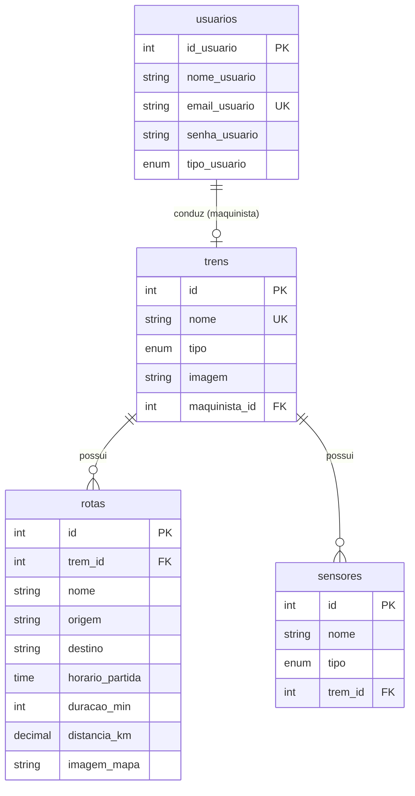

# Red Rush — SA Ferrorama

Sistema web para gerenciar uma operação ferroviária: **trens**, **rotas**, **horários**, **sensores** e as pessoas envolvidas (administradores, funcionários/maquinistas e clientes). Projeto da SA do curso técnico em Desenvolvimento de Sistemas.

## Funcionalidades

- Login com três perfis (administrador, funcionário e cliente), cada um com o seu painel.
- CRUD completo de **trens**, **rotas**, **sensores** e **usuários**.
- Cada trem pode ter **um maquinista** (um funcionário) associado.
- Horários e mapas das rotas lidos do banco (a chegada é calculada: partida + duração).

## Quem pode fazer o quê

| Ação | Cliente | Funcionário | Administrador |
|---|:---:|:---:|:---:|
| Ver trens, rotas, horários e mapas | ✅ | ✅ | ✅ |
| Cadastrar / editar trens, rotas e sensores | ❌ | ✅ | ✅ |
| Ver lista de clientes e cadastrar clientes | ❌ | ✅ (só clientes) | ✅ (todos os perfis) |
| **Excluir** trens, rotas e sensores | ❌ | ❌ | ✅ |
| Editar / excluir usuários e mudar perfis | ❌ | ❌ | ✅ |

A checagem é feita no servidor, no começo de cada página, pelos arquivos `verifica_login.php`, `verifica_acesso.php` (administrador e funcionário) e `verifica_admin.php` (só administrador).

## Tecnologias

PHP (mysqli) · MySQL/MariaDB · HTML · CSS (`assets/style/style.css`) · XAMPP · Git/GitHub

## Como rodar (XAMPP)

1. Instale o [XAMPP](https://www.apachefriends.org/) e ligue **Apache** e **MySQL**.
2. Copie esta pasta para `C:\xampp\htdocs\` (fica `htdocs\SA-Ferrorama`).
3. Abra `http://localhost/phpmyadmin`, vá na aba **Importar**, escolha `Db/Database.sql` e clique em **Importar**.
4. Se o seu MySQL tiver usuário ou senha diferentes de `root` / (vazia), edite `infra/conexao.php`.
5. Acesse `http://localhost/SA-Ferrorama/`.

O `Database.sql` **apaga e recria** o banco `SA_Ferrorama`. Se já existir um banco com esse nome, os dados dele serão perdidos.

O banco começa sem trens, rotas ou sensores: cadastre pelo sistema. As imagens dos trens e dos mapas são escolhidas entre os arquivos da pasta `assets/imag`.

### Senha do administrador inicial

O `Database.sql` cria o admin `Marcos_Voltolini@gmail.com`. Para definir uma senha nova, gere o hash e atualize no banco:

```
C:\xampp\php\php.exe -r "echo password_hash('SuaNovaSenha', PASSWORD_DEFAULT);"
```

```sql
UPDATE usuarios SET senha_usuario = 'COLE_O_HASH_AQUI' WHERE email_usuario = 'Marcos_Voltolini@gmail.com';
```

Logado como administrador, use **Usuários > Cadastrar usuário** para criar funcionários (que podem ser maquinistas) e outros administradores.

## Banco de dados



- `trens.maquinista_id` é único: um maquinista conduz no máximo um trem. Se o usuário for excluído, o trem fica sem maquinista.
- Um trem que ainda tem rotas ou sensores não pode ser excluído.
- O e-mail do usuário e o nome do trem são únicos.

## Estrutura do projeto

```
SA-Ferrorama/
├── index.php                    página inicial
├── dashboard_admin.php          painel do administrador
├── dashboard_funcionario.php    painel do funcionário (mostra o trem que ele conduz)
├── dashboard_comum.php          painel do cliente
├── assets/                      imagens e style.css
├── Db/Database.sql              banco completo
├── infra/conexao.php            conexão com o banco
├── pesquisas/                   APIs, PDO, CRUD, Scrum, XAMPP e Kanban
└── public/
    ├── login.php, logout.php
    ├── cabecalho.php                    cabeçalho e menu, usado pelas páginas
    ├── verifica_login.php, verifica_acesso.php, verifica_admin.php
    ├── Listar_trens.php, cadastro_trem.php, editar_trens.php, atualizar_trem.php, excluir_trens.php
    ├── Listar_rotas.php, adicionar_rota.php, editar_rotas.php, atualizar_rota.php, excluir_rotas.php
    ├── Listar_sensor.php, cadastro-sensor.php, editar_sensor.php, atualizar_sensor.php, excluir_sensor.php
    ├── Listar_clientes.php, cadastrar_usuario.php, cadastrar_admin.php,
    │   editar_clientes.php, atualizar_clientes.php, excluir_clientes.php
    └── Horario_trem.php, Rota_trem.php
```

Padrão de cada CRUD: `Listar_` mostra a tabela, `cadastro_`/`adicionar_` cria, `editar_` mostra o formulário preenchido, `atualizar_` grava a edição e `excluir_` apaga.

## Segurança aplicada

- Senhas com `password_hash`; nenhuma tela lê ou mostra a coluna de senha.
- Consultas com *prepared statements* (sem SQL Injection).
- Textos vindos do banco são escapados com `htmlspecialchars`.
- Exclusões só aceitam POST (antes eram links) e só para administrador.
- Todas as páginas, menos `index.php` e `login.php`, exigem login.

## Documentação da equipe

- [`pesquisas/Kanban.md`](pesquisas/Kanban.md): quadro Kanban e backlog
- [`pesquisas/`](pesquisas/): APIs, PDO, CRUD, Scrum e XAMPP

## Licença

O arquivo `LICENSE` está vazio. Escolham uma licença (ex.: MIT) ou deixem explícito que o projeto é de uso acadêmico.
